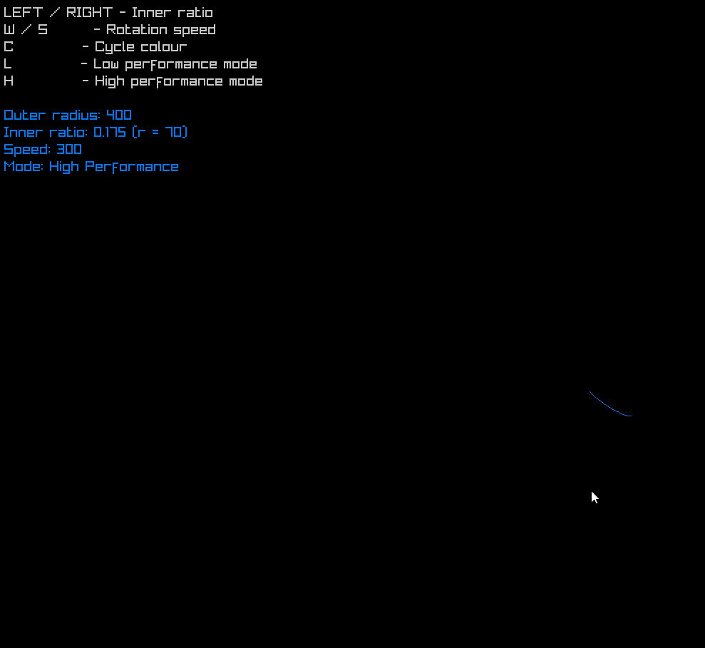

# Hypothrochoid

A small [raylib](https://www.raylib.com/) toy that draws a live **hypotrochoid**: the curve traced by a point attached to a circle rolling around the inside of a larger circle. You can change the circles, speed and colour from the keyboard while it runs.



## How it works

- The **outer circle** has radius `R` and sits in the centre of a 1000×1000 window.
- The **inner circle** has radius `r = R * ratio`, so its size always scales with the outer circle.
- The inner circle's centre orbits at distance `R - r`, moving at `moveSpeed` degrees per second (`alpha`).
- As it rolls, the inner circle spins the other way at `-moveSpeed * (R - r) / r`.
- The pen point is fixed to the inner circle at `drawOffset` (75 px from its centre). Its position is recorded every `drawRate` seconds, and the last `maxDrawPoints` points are drawn as a line strip.

Any change to a setting clears the drawing and starts it again from `alpha = 0`.

## Controls

| Key | Action | Step | Range |
|---|---|---|---|
| `UP` / `DOWN` | Increase / decrease outer radius `R` | 10 px | 50 – 480 |
| `RIGHT` / `LEFT` | Increase / decrease inner-to-outer `ratio` | 0.025 | 0.05 – 0.95 |
| `W` / `S` | Increase / decrease rotation speed `moveSpeed` | 10 °/s | 0 – 1000 |
| `C` | Cycle colour: Red → Green → Blue → White → … | | |
| `L` | Low Performance Mode | | |
| `H` | High Performance Mode (default) | | |

Each press changes a setting by one step. The controls and current values are shown in the top-left corner of the window.

### Performance modes

| Mode | `drawRate` | `maxDrawPoints` |
|---|---|---|
| High (default) | 0.005 s | 2000 |
| Low | 0.15 s | 50 |

Low Performance Mode records points less often and keeps fewer of them, so it draws a shorter, more angular trail at a lower cost.

## Building

Requirements:
- Visual Studio 2022 with the **Desktop development with C++** workload
- raylib 6.2.0, installed through NuGet (`packages.config`). Visual Studio restores it on the first build.

Steps:
1. Open `Hypothrochoid/Hypothrochoid.sln`.
2. Select the **Debug | x64** configuration.
3. Build and run (`F5`).

## Tweaking

All tunable values are at the top of [`main.cpp`](Hypothrochoid/Hypothrochoid/main.cpp):

- Starting values: `R`, `ratio`, `moveSpeed`, `drawOffset`, `colorIndex`
- Step sizes: `RADIUS_INCREMENT`, `RATIO_INCREMENT`, `SPEED_INCREMENT`
- Limits: `MIN_R` / `MAX_R`, `MIN_RATIO` / `MAX_RATIO`, `MIN_SPEED` / `MAX_SPEED`
- Performance presets: `HIGH_PERF_*` / `LOW_PERF_*`
- Colour list: `colors[]`

## Project layout

```
README.md
Hypothrochoid/
├── hypo.gif                  # demo recording
├── Hypothrochoid.sln
└── Hypothrochoid/
    ├── main.cpp              # settings, input, drawing
    └── DuckTools.h           # PolarToVector helper
```
